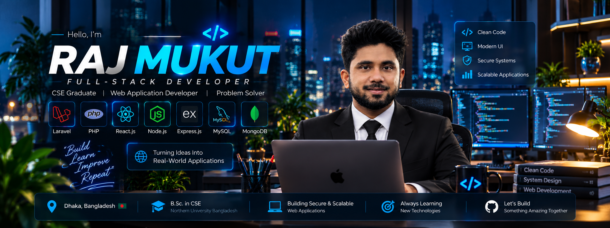

  

**FULL-STACK DEVELOPER**  
Dhaka, Bangladesh · CSE Graduate

 

&nbsp;

 

## Selected Work

<table>
<tr>
<td colspan="2" valign="top">

### 01 &nbsp; / &nbsp; NUB Connect
**A connected university community.**

Students, alumni and mentors — newsfeeds, messaging and opportunities.

`Laravel` &nbsp; `MySQL` &nbsp; `Tailwind CSS`

</td>
</tr>
<tr>
<td width="50%" valign="top">

### 02 &nbsp; / &nbsp; Nirbhoy Bangladesh

Public reporting with evidence tracking and verification.

`Laravel` &nbsp; `Livewire` &nbsp; `MySQL`

</td>
<td width="50%" valign="top">

### 03 &nbsp; / &nbsp; MedhBook

Appointments and medical records in one healthcare platform.

`React` &nbsp; `Node.js` &nbsp; `MongoDB`

</td>
</tr>
</table>

 

### The Stack

  

---

 

[**Explore my work ↗**](https://github.com/rajmukut1628?tab=repositories)

 

